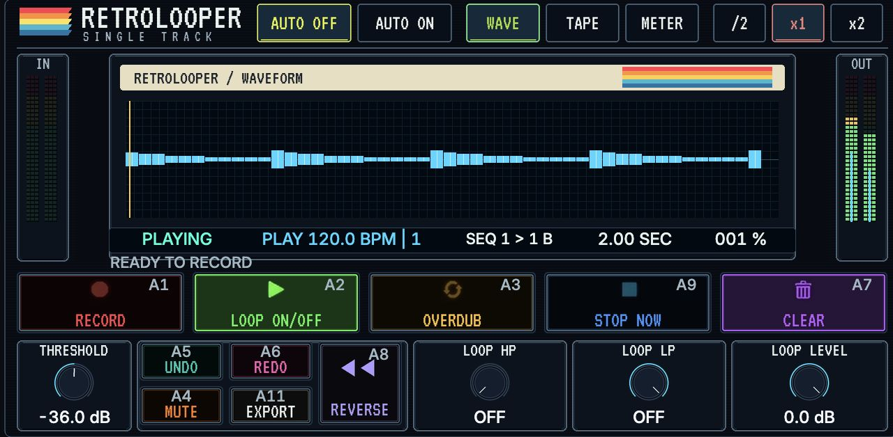
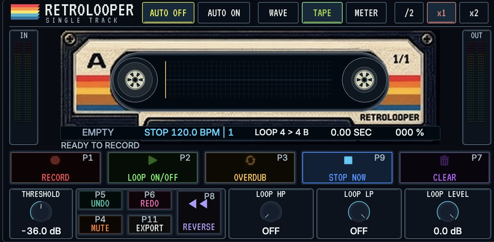
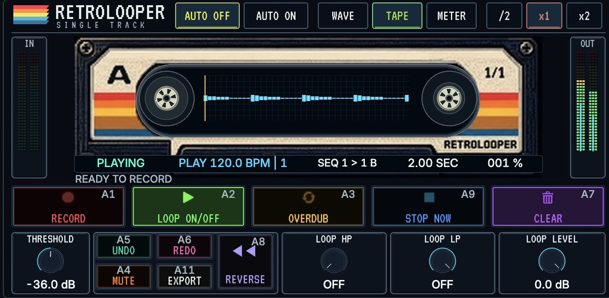
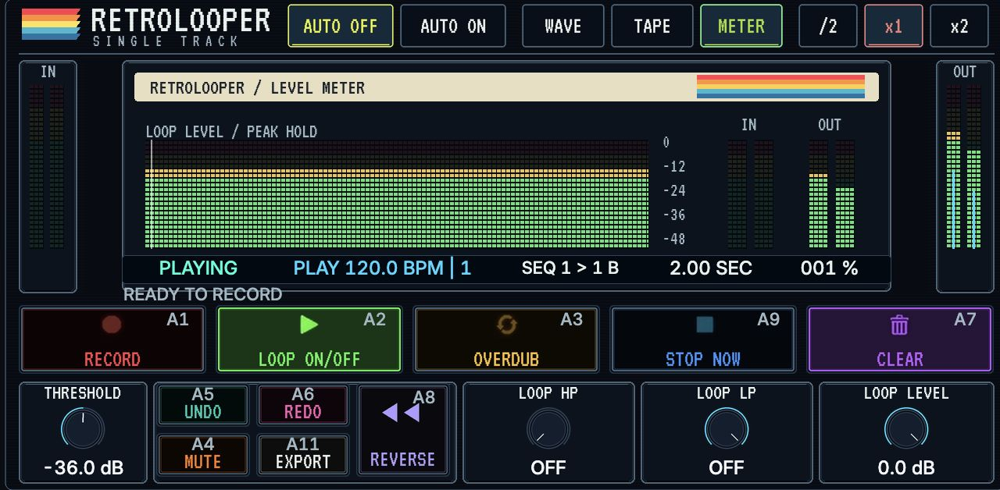

# Retrolooper One for MPC and Force

Both Gen1 ARMv7 effect packages use the same portable core and retain their existing plug-in IDs for project recall. No native helper is required. On the host Audio track, use Monitor MERGE and turn native REC ARM off to avoid recording to the timeline too. Use the looper touchscreen, MIDI or Q-Links.

The looper follows host tempo and transport. If the host does not report a cycle range, set **Take Bars** on Mixer; the length multiplier still applies. Both effects export WAV on their own. Native track and pad integration, MPC timeline bounce, and Force Matrix bounce are available through optional firmware-specific Device patches.

Download the effect ZIP for your device. Gen2 builds are outside this release. Install the matching Controls patch separately if you use one of the exact host builds in its guide.

| Device | Standalone effect | Optional Controls |
| --- | --- | --- |
| MPC One+ | [Retrolooper One 0.3.9](https://github.com/asearan/Retrolooper-One-MPC-Force/releases/tag/mpc-v0.3.9) | [MPC 3.10.0.49 guide](docs/retrolooper-controls-mpc.md) |
| Force | [Retrolooper One 0.2.10](https://github.com/asearan/Retrolooper-One-MPC-Force/releases/tag/force-v0.2.10) | [Force 3.10 guide](docs/retrolooper-controls-force.md) |

Read the [MPC guide](docs/MPC-ONE-PLUS.md), [Force guide](docs/FORCE.md), and [build instructions](docs/BUILDING.md).

## On the device

| MPC One+ | Force |
| --- | --- |
|  |  |
|  |  |

If Retrolooper One is useful to you, you can [support development via PayPal](https://paypal.me/adamsearan).

## Trademarks

VST is a registered trademark of Steinberg Media Technologies GmbH.

Audio Units is a trademark of Apple Inc.

Copyright © 2026 IAMTHEBAND LLC, Retroloop USA. GPL-3.0-only.
