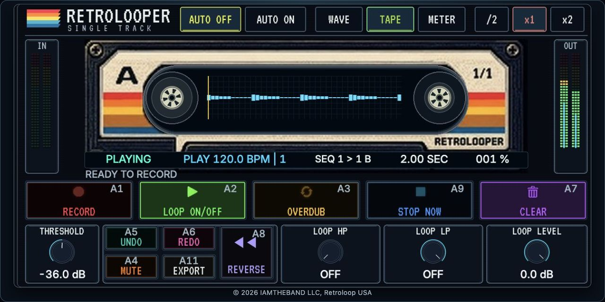
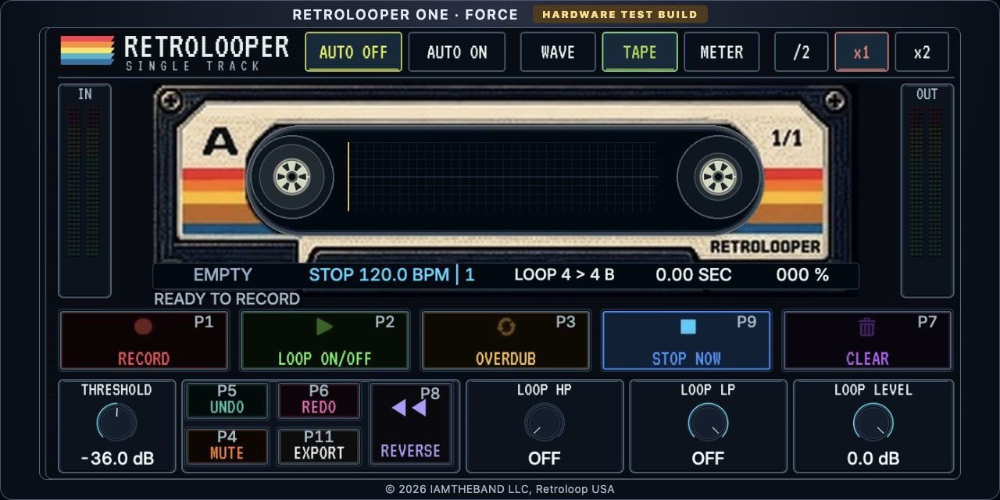

# RetroLooper One — MPC One+ and Force

Copyright © 2026 IAMTHEBAND LLC, Retroloop USA.

A single stereo audio-track looper: record a first take, add overdubs and keep playback aligned to the host. The product name is RetroLooper One on both devices. Each device edition has its own plugin ID and matching integration helper.

| Device | Plugin | Matching helper | Status |
|---|---|---|---|
| MPC One+ | RetroLooper One 0.3.6 | MPC integration 0.2.7 | Hardware tested on modified MPC 3.10.0.49 |
| Force | RetroLooper One 0.1.0 | Force Controls 0.1.0 | Experimental hardware test build; live functional checks pending |

## Support development

If Retrolooper One is useful to you, you can support its development with an optional PayPal donation. [Donate via PayPal](https://paypal.me/adamsearan).

## Install

Use a current OpenMPC catalog installer. Select the **plugin for your device**; its exact matching helper is declared as a dependency and is added to the same install batch. Save your project before the installer restarts the device application. Only one RetroLooper insert effect appears in the effect picker; the helper runs in the background.

For direct downloads, use the clearly labeled **complete** archive for your device from [Releases](https://github.com/asearan/Retrolooper-One-MPC-Force/releases). Each complete archive contains the plugin ZIP, matching helper ZIP, README and checksums. For an older installer without dependency support, extract it and import both component ZIPs into one batch. Never exchange MPC and Force helpers.

- [MPC One+ installation and use](docs/MPC-ONE-PLUS.md)
- [Force experimental installation and use](docs/FORCE.md)
- [Build instructions](docs/BUILDING.md)
- [Validation and limits](docs/TESTING.md)

These releases require an existing community-plugin-enabled/rooted device and the exact supported host build. They are not installers for stock firmware or Gen2 hardware.

## Features

- One stereo loop per insert, up to two minutes, with four undo levels and sequence-sized memory allocation.
- Touch and assigned pads control Record, Play/Stop, Overdub, Mute, Clear, Undo/Redo and Reverse.
- Host clock, transport and phase alignment; host loop length with /2, x1 and x2. MPC uses sequence length; Force targets the global Arrange loop.
- Optional threshold start, main-page HP/LP filters and Q-Link/MIDI assignment.
- Waveform, cassette and meter views; cue blinking and active-state colours.
- Opening an instance selects its owning Audio track and pad grid. Other recorded loops keep playing; capture is selected-track scoped.
- Native Track Mute, Pad Mute and other supported performance modes regain their normal pads and colours.
- WAV export and project recall.

**Export currently writes a WAV file. Automatic placement on the native Audio timeline is not implemented.** To print insert effects into a layer, place them before RetroLooper in the channel's chain. A looper cannot record effects after its insert position.

The screenshots below are captures of the native-skin testbench, which uses the same artwork and control geometry. They are UI previews, not claims of additional hardware testing.

## Force preview — experimental

## License

GPL-3.0-only; see [LICENSE](LICENSE) and [third-party notices](THIRD_PARTY_NOTICES.md). No proprietary firmware or SDK is distributed. Source for the port, compiled engine and integration helpers is included.
