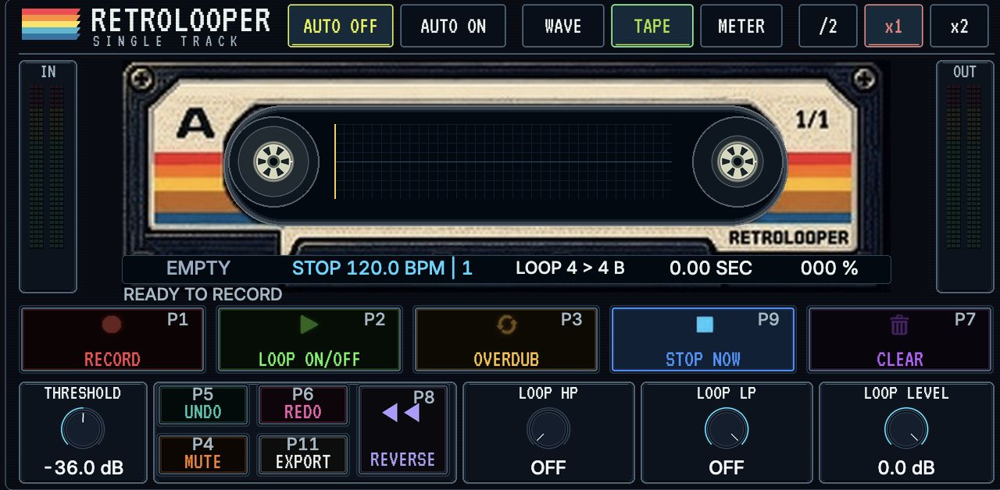

# Retrolooper One on Akai Force

Install the Force effect ZIP as an Audio insert. Retrolooper One 0.2.10 keeps the existing `RlF1` VST ID and runs without Controls. The host must already support Gen1 ARMv7 community VST2 loading. Use native Monitor MERGE and REC ARM OFF for loop-only input capture. Place any effects to be printed before the looper.

Cue a take or overdub on the touchscreen, assign MIDI or a Q-Link if desired, and run Force Play. Retrolooper follows host transport and tempo. When Force supplies a valid cycle range, Retrolooper uses it; otherwise set Take Bars on Mixer. WAV export is available without Controls.

**Timing → Record Offset** defaults to **Auto (7 ms)** for recording through the built-in Force inputs. The offset applies to new takes and overdubs. Choose **0 ms** for a source that is already aligned or dial in a manual value for another input path. Nonzero manual settings from 0.2.7 carry forward.

The separate Force Controls patch adds track and editor follow, capture routing, the bottom two physical pad rows and Bounce to Clip on the supported Force 3.10 host image. [Force Controls patch](retrolooper-controls-force.md)

With Controls 0.2.10, finish recording or overdubbing and tap **CLIP**. The button blinks while waiting. Press a destination pad to select its clip and bounce while the looper stays open. You can also open Matrix and select an Audio slot on the touchscreen. The transport can keep playing. An occupied slot is replaced.

## Trademarks

VST is a registered trademark of Steinberg Media Technologies GmbH.

Audio Units is a trademark of Apple Inc.
