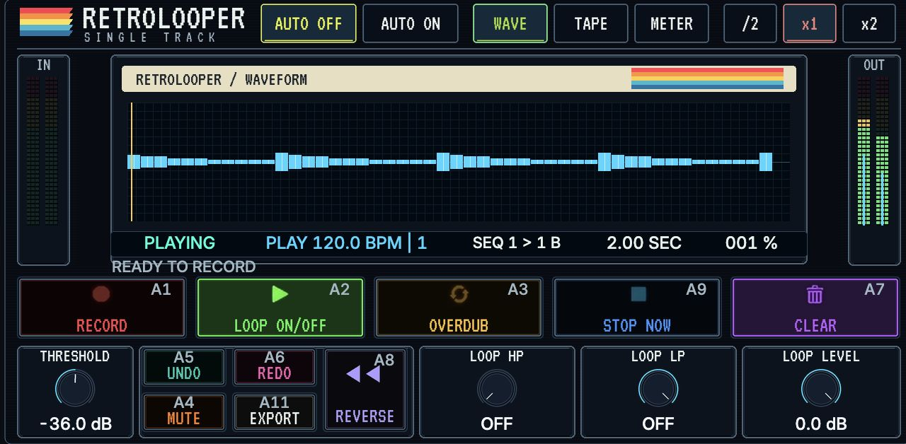

# Retrolooper One on MPC One+

Install the MPC effect ZIP as an Audio insert. Retrolooper One 0.3.9 keeps the existing `RlO1` VST ID and runs without Controls. The host must already support Gen1 ARMv7 community VST2 loading. Use native Monitor MERGE and REC ARM OFF for loop-only input capture; place any effects to be printed before the looper.

When upgrading from an older `RetroLooper - VST - RetroLooper One` folder, back up its Loops and Exports first. The new folder is `RetroLooper - VST - Retrolooper One`, spelled exactly like the product name so the Akai can find the custom screen. Copy the backed-up Loops and Exports into the new folder if the installer did not migrate them. Check your saved project before retiring the old installation.

Cue a take or overdub on the touchscreen, assign MIDI or a Q-Link if desired, and run MPC Play. Retrolooper follows host transport and tempo. If the host does not supply a usable cycle range, set Take Bars on Mixer. Tap **EXPORT** to save a WAV in **RetroLooper Exports** on the internal drive. Import that WAV manually into an MPC Audio track.

The separate [MPC Controls patch](retrolooper-controls-mpc.md) adds Bank A colours and actions, track selection, selected-track MERGE routing and timeline bounce on the supported modified MPC One+ 3.10.0.49 host image. With transport stopped, **EXPORT** also places the loop at bar 1 on the selected Audio track when the destination range is empty. MPC Undo removes the region. Other device and firmware combinations have not been validated.

## Trademarks

VST is a registered trademark of Steinberg Media Technologies GmbH.

Audio Units is a trademark of Apple Inc.
